# SafetyAudit: test report for cross-guideline answer reuse

**Date:** 11 November 2026
**Branch:** `feat/ai-evidence-assessment` (after the merge of GitHub `main`, merge commit `e7a97d7`)
**Feature under test:** PR #13, "cross-guideline answer reuse" (commit `3bb7d2d`)
**Tested by:** Claude Code, at the project owner's request

> **Update:** sections 1 to 8 describe the feature as first merged. Behaviour changed afterwards (links per project, project head auditor reviews, decisions per project). See **section 9** for what is current and what was fixed.

---

## 1. What the feature does

When an admin uploads a guideline, an AI (Groq) compares its items with the items of every other guideline and proposes **links**: "same requirement" (`equivalent`) or "partly overlaps" (`partial`). An admin confirms or rejects each link. Later, when an auditor works on a new project, the app looks for items already answered in an earlier **approved** project on the same platform and offers to reuse those answers. Only `equivalent` links can be reused in one click.

---

## 2. Summary

| Area | Result |
|---|---|
| Automated tests (backend, frontend, type checks) | **Pass**. One backend test timed out under load and passed when run alone. |
| New tests for the feature (32, added in this round) | **Pass**, and they catch a broken rule (checked by breaking one on purpose). |
| Database tables and the 7 new routes, live | **Working**. Tables exist and hold real data. |
| Admin "Linked items" screen, live, real data | **Working** |
| Auditor "from earlier audits" screen | **Working, but tested with simulated data** (no real earlier approved project exists for the demo accounts) |
| AI link generation, live | **Not tested live** (see section 6) |
| Real accept / dismiss against the real database | **Not tested live** (see section 6) |

---

## 3. Automated tests

| Check | Result |
|---|---|
| Backend type check (`tsc`) | Clean |
| Frontend type check (`tsc`) | Clean |
| Frontend unit tests | 332 / 332 pass |
| Backend tests, full run | 2 673 / 2 674. The failure was a 10-second setup timeout in `highlight.settle.test.ts` while the whole suite ran; run alone it passed 20 / 20. |
| New: `mappingService.test.ts` | 32 / 32 pass |

The 32 new tests (commit `c1e6988`) run the real matching code against an in-memory stand-in for the database. They cover:

- **AI matching:** a match is stored as a suggested, ordered pair; only look-alike candidates are sent to the model; already-linked and rejected pairs are not asked about again; invented references are ignored; an unknown relation becomes `partial`; confidence is kept within 0 to 1; if every batch fails, the call fails with a clear error.
- **Suggestions:** only confirmed links count; only approved projects on the same platform that the auditor belongs to are used; answered, dismissed and deactivated items are skipped; disagreeing auditors are skipped unless someone resolved it; equivalent beats partial; nothing is offered once the project is in review.
- **Accept and dismiss:** accept copies status, findings, evidence and a "Reused from ..." note and records the decision; partial links are never accepted in bulk; an answer saved in the meantime is never overwritten; a locked project is refused; dismiss records the decision.

To check these tests can fail, the "equivalent only" rule was removed on purpose: exactly the matching test failed. The file was then restored.

---

## 4. Live test: admin side (real backend, real database)

**Setup:** a fresh copy of the backend (port 3100) and frontend (port 5174) from this branch, using the real Supabase database, signed in as the seeded **Demo Admin**. Nothing in the database was changed by this part.

| Check | Result |
|---|---|
| Login with the demo admin | Works |
| `GET /api/mappings/coverage` | 200. 6 guidelines, 19 links: **10 awaiting review, 7 confirmed, 2 rejected**; **6 answers reused, 1 dismissed** |
| `GET /api/mappings` | 200. Every link returns both items with guideline, code, text and clause |
| Browser console and network | No errors |

### Screenshots

**Login**

**Admin dashboard**: 6 guidelines, 560 checklist items.

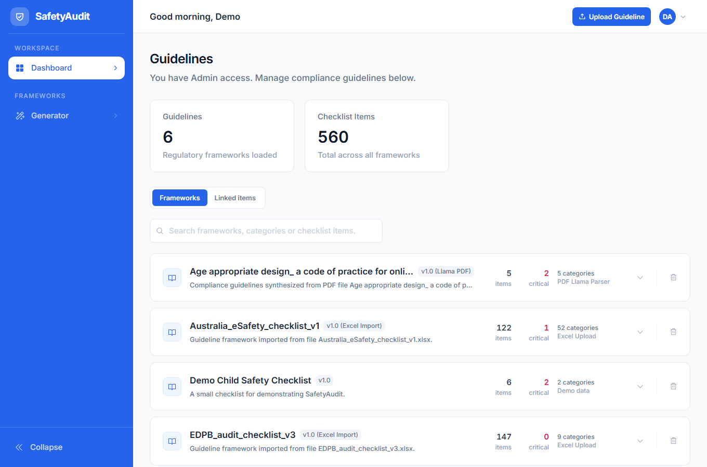

**Linked items tab**: 7 confirmed links, **78 % AI match precision** (7 confirmed out of 9 reviewed), **86 % of suggestions accepted** (6 of 7). "Find links" lets the admin pick a framework and run the AI.

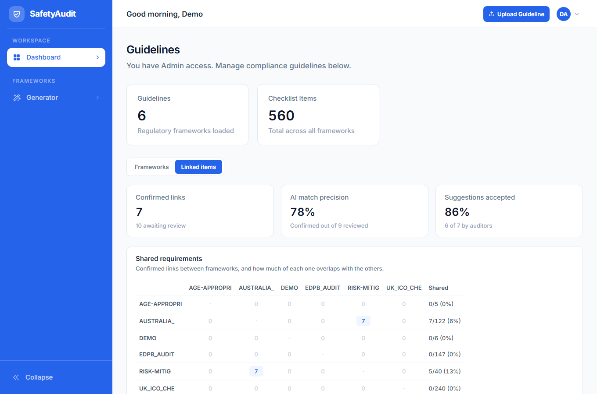

**Confirmed links** and the overlap table ("Shared requirements"): AUSTRALIA_ and RISK-MITIG share 7 linked items.

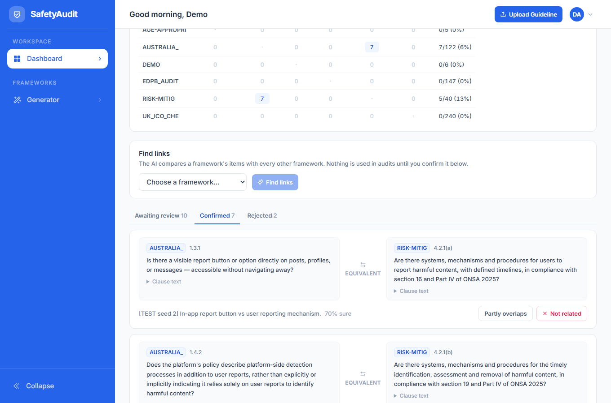

**Rejected links**

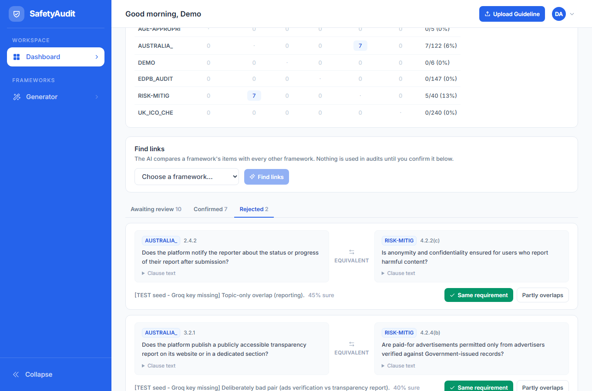

**Awaiting review**: each link shows both items side by side, the relation, the AI's reason, and three buttons: *Same requirement*, *Partly overlaps*, *Not related*.

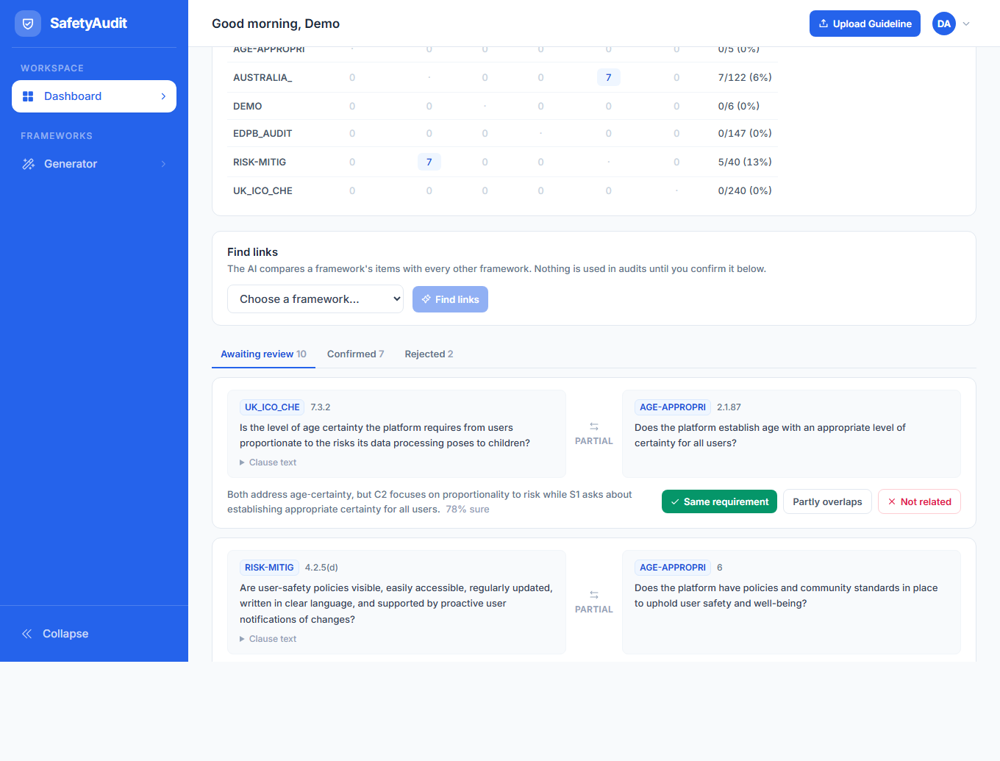

---

## 5. Live test: auditor side (real UI, simulated suggestions)

**Why simulated:** the demo accounts have no earlier *approved* project, so the real API correctly returns an empty list (`200 []`) for both demo projects. To see the screens, the browser was given a made-up list of 3 suggestions for the 3 unanswered items of "Demo: TikTok child-safety audit". Everything else (login, page, checklist, score) was real. The simulated accept and dismiss calls were answered in the browser, so **nothing was written to the database** (checked afterwards: still 3 answers, still 19 links, still 6 accepted and 1 dismissed).

**Banner**: "3 from earlier audits" appears next to the progress figures.

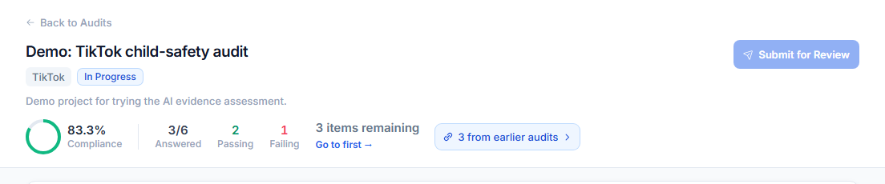

**List**: "Use all 2 matching answers" plus the three items. The partly related one is marked and left for the auditor.

**On the item itself**: the earlier answer, source project, guideline clause, date, number of photos and findings, with *Use answer* and *Dismiss*.

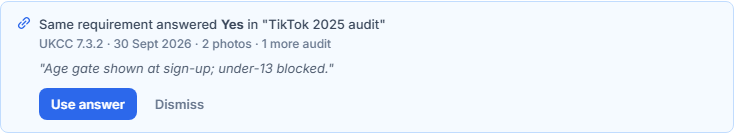

**After Dismiss**: the list drops to "2 from earlier audits / Use all 1 matching answer". The browser sent the right request (the item and its source item).

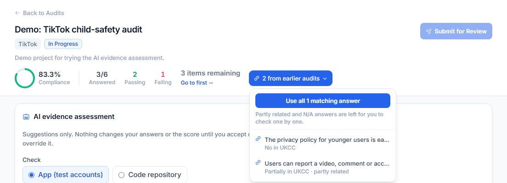

**After "Use all"**: the page moves to 4 / 6 answered and 62.5 % compliance, because the reused "No" answer counts as failing. The request carried only the one equivalent item.

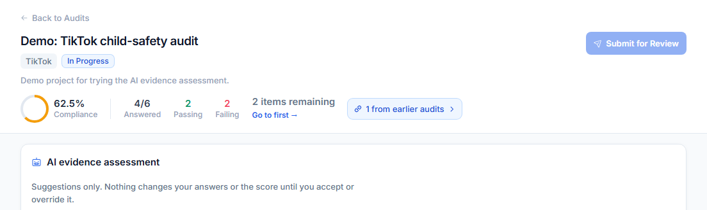

---

## 6. What was not tested, and why

| Not tested | Why |
|---|---|
| **Running the AI to create new links** (`POST /api/guidelines/:id/mappings/generate`) | It writes new link rows to the shared database and calls Groq. The tool that guards shared resources refused the call, so it was not run or worked around. |
| **Real accept / dismiss writing to the database** | Needs an approved earlier project on the same platform, which the demo data does not have. Creating one means writing projects and answers to the shared database. |
| **Quality of the AI's links with the model in `.env`** | Same reason as the first row. The existing data (78 % precision) is the only evidence. |
| **Reused answers together with AI evidence assessment** | Needs the real flow above. The merge notes say the answer-update path was reconciled by hand. |

The unit tests cover the logic behind the first two rows, but not the real database or the real model.

---

## 7. Findings

| # | Severity | Finding |
|---|---|---|
| 1 | Low | **AI explanations contain internal labels.** The stored reason for a link says "C2 focuses on ... while S1 asks about ..." (see the first card in the *Awaiting review* screenshot). "S1" and "C2" are the prompt's internal names and mean nothing to the admin. Fix: tell the model not to use them, or replace them with "this item" and "the other item" before saving. |
| 2 | Low | **The Linked items tab shows zeros while loading.** For several seconds after login the cards show "0 guidelines", "0 confirmed", "n/a" and "Nothing here yet", which looks like an empty system. A loading state would be clearer. |
| 3 | Medium (setup) | **Two migration folders with overlapping numbers.** Cross-guideline: `backend/migrations/001`, `002`. Evidence: `backend/supabase/migrations/001`, `002`, `003`. Both sets must be applied. The live database already has the cross-guideline tables, so it is applied there. |
| 4 | Medium (quality) | **Model setting.** Link generation uses `GROQ_MODEL`. `.env.example` sets it to `llama-3.1-8b-instant`, but the code was written for `llama-3.3-70b-versatile`. The smaller model may produce weaker `equivalent` links. Admin review limits the harm. Which value the real `.env` holds was not checked. |

---

## 8. How this was run (to repeat it)

1. `cd backend`, then `PORT=3100 ALLOWED_ORIGINS=http://localhost:5174 npx tsx src/server.ts`
2. `cd frontend`, then `VITE_API_URL=http://localhost:3100/api npx vite --port 5174 --strictPort`
3. Sign in with the demo accounts from `backend/scripts/seedDemo.ts`.
4. Both servers were stopped afterwards. The backend on port 3000 that was already running was not touched.

---

## 9. Update: changes made after this test, and their results

### What changed
| Change | Detail |
|---|---|
| Links only between the guidelines a project uses | The AI no longer compares a guideline with the whole library. It runs when a project's guidelines are saved and compares only those guidelines. Guideline upload no longer starts matching. |
| The project's head auditor reviews the links | New **Review linked requirements** panel on the audit page (find links, confirm, mark not related, and a **Decided here** list with *Back to review*). The admin Linked items tab remains. |
| Decisions belong to one project | A head auditor's decision applies to that project only and never changes the shared link. Without a decision the shared status applies. New table `Project_Mapping_Decision` (migration `006`). |
| Reuse also works inside one project | An answer given under one guideline is offered for the linked item of another guideline in the same project (the auditor's own answers only). |
| Roles unchanged where decided | Auditors accept and dismiss; head auditors do not. |

### Fixes for the findings in section 7
| # | Finding | Result |
|---|---|---|
| 1 | AI reasons contained "S1" and "C2" | Fixed. The prompt forbids the labels and any that remain are replaced by "this item" and "the other item". Tested. |
| 2 | Zeros while loading | Fixed. The Linked items tab says "Loading linked items…" until the data arrives. Tested. |
| 3 | Two migration folders | Fixed. The cross-guideline SQL moved to `backend/supabase/migrations` as `004`, `005`, plus new `006`. README updated. |
| 4 | Model setting | Fixed. Matching uses its own `MAPPING_GROQ_MODEL` and no longer follows `GROQ_MODEL`. The live test showed the first default I chose (`llama-3.3-70b-versatile`) is **not available** to this Groq account, so the default is now `openai/gpt-oss-120b`. Tested. |

### New problem found and fixed while testing the evidence interaction
After **Use answer**, the page did not refresh the project's score or move a draft project to "in progress", unlike every other saved answer. Four new tests cover it; three failed before the fix and pass now.

### Test results
| Check | Result |
|---|---|
| Mapping service tests | 58 pass (was 32). New: scoped matching, project matching, project decisions, same-project reuse, labels, model setting |
| Route tests (new, over HTTP) | 23 pass: every route, each role, bad input, locked projects, project ownership. Removing the ownership check makes two fail, so they do catch it. |
| Frontend | 357 / 357 pass, type check clean |
| Browser end-to-end (Playwright) | 7 / 7 pass |
| Backend, full run | 2 823 of 2 826 pass; type check clean. Three failures are outside this feature: two prompt-text tests in `appAgent.test.ts` and `assess.test.ts`, files with uncommitted edits by the project owner, and one timing test (`highlight.settle`) that passes when run alone (20 / 20). |

### Database changes made with the owner's approval
- The 10 links created on 20 October that were still awaiting review were **deleted**. A safety check required exactly 10 rows, all awaiting review and dated before November, and the counts afterwards matched (7 confirmed and 2 rejected untouched).
- **11 other links** appeared at about 02:59 local time on 11 November, between RISK-MITIG, AUSTRALIA_ and UK_ICO_CHE. They were not created by this testing and were **left alone**. They look like a "Find links" run from the app. They are awaiting an admin's decision.

### Live test on the real database (after migration 006)

**Setup:** the demo accounts, the real Supabase database, the real Groq AI, the real web pages (no stubs). A scratch project `[TEST-LINKS] scratch project` with two small guidelines (AGE-APPROPRI, 5 items, and RISK-MITIG, 40 items). Everything it created was removed afterwards, and every table was compared with a snapshot taken before.

**Problems the live test found (the automated tests could not have)**
| Problem | What happened | Fix |
|---|---|---|
| Wrong default model | Groq answered "model does not exist or you do not have access" for `llama-3.3-70b-versatile`; this account serves no Llama models. | Default changed to `openai/gpt-oss-120b`. |
| Row-level security on the new table | The Supabase SQL editor created `Project_Mapping_Decision` with row-level security on, so saving a decision failed (and reads would have come back silently empty). | `alter table ... disable row level security`, now also in `006_project_mapping_decision.sql`. |

**Results (all pass)**
| Step | Result |
|---|---|
| Create a project and assign two guidelines | Works |
| Real AI matching for the project | Works: 3 to 6 links in 17 to 52 seconds, no failed batches. Every link was between the two assigned guidelines only. |
| An auditor asks for the project's links | Refused (403) |
| Head auditor confirms a link | Saved for this project. **The shared link stayed "awaiting review"**. |
| The auditor answers one linked item | The linked item in the other guideline is offered the same answer, from the same project |
| Head auditor: confirm, "Back to review", confirm again (real page) | Works; shared links untouched |
| Auditor banner (real page) | "2 from earlier audits" |
| "Use answer" (real page) | The answer, a "Reused from ..." note, and the status were saved in the database |
| "Dismiss" (real page) | Recorded; the suggestion disappears |
| Accepted and dismissed choices | Both recorded in the database |
| A head auditor tries to accept | Refused (403) |
| Clean-up | Project, answers, decisions, members, clones and the AI's new links removed; all 8 tables match the snapshot |

The AI returned links that all shared items in one run, so for the accept and dismiss steps **two clearly labelled test links** ("TEST LINK created by the live test; removed afterwards") were added by the script between unused items. They are visible in the first screenshot below and were deleted with the rest.

### Screenshots from the live test

**Head auditor: Review linked requirements.** Links between this project's two guidelines only, with the three decision buttons and the "Decided here" list.

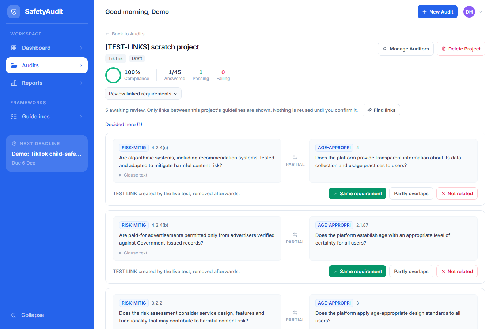

**Decided here.** The link just confirmed for this project.

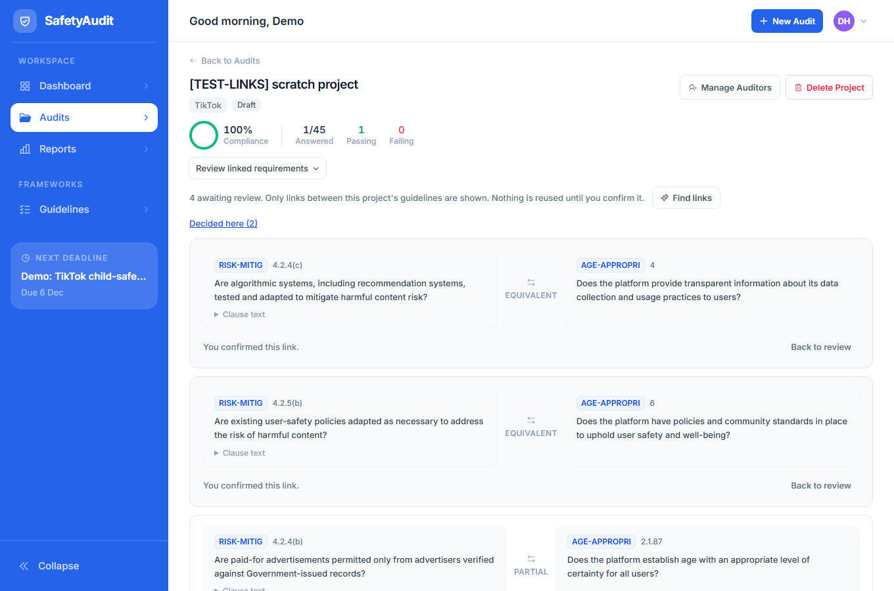

**Back to review.** One decision removed again.

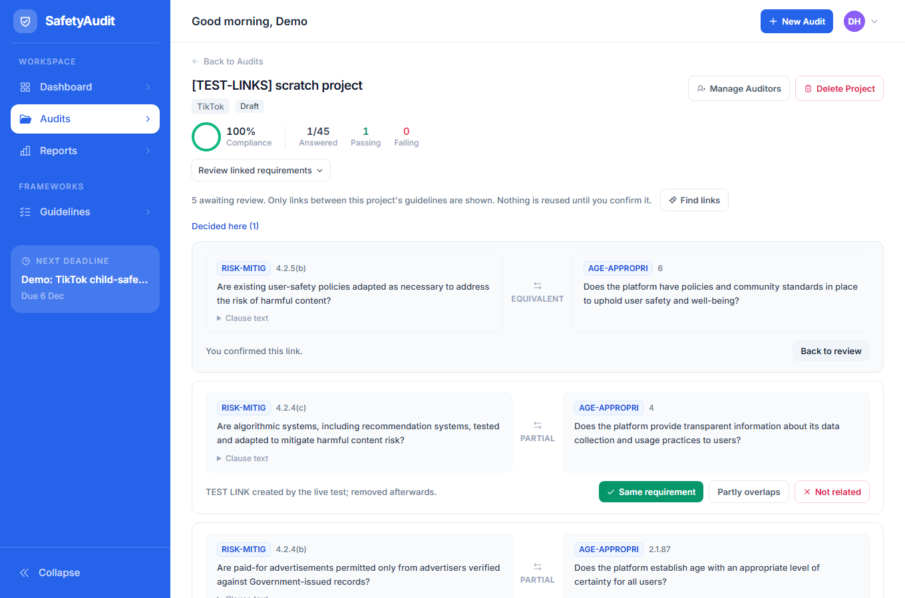

**Auditor: banner.** "2 from earlier audits".

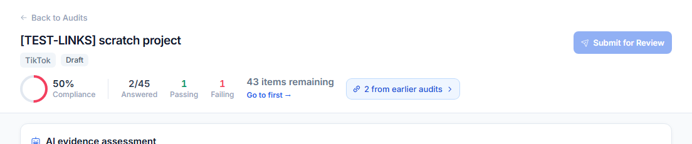

**Auditor: the list.**

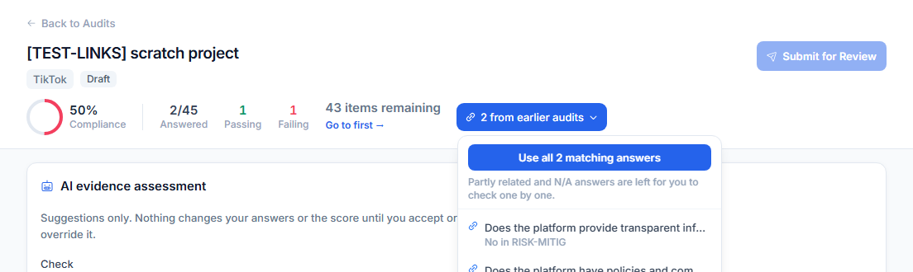

**Auditor: the item card.** The earlier answer, from the same project, with Use answer and Dismiss.

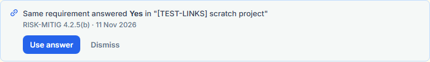

**After Use answer.**

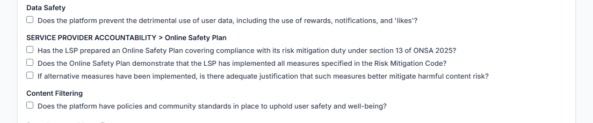

**After Dismiss: nothing left.**

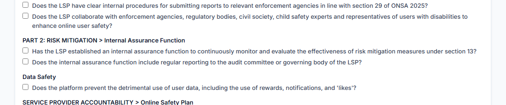

### Still open
| Item | Note |
|---|---|
| The 11 links from 11 November | Created at about 02:59 local time between RISK-MITIG, AUSTRALIA_ and UK_ICO_CHE, not by this testing. Still awaiting an admin's decision. |
| Backend tests outside this feature | Two prompt-text tests in files with uncommitted edits, and one timing test that passes alone. |
| AI link quality | One live sample only (3 to 6 links per run, mostly "partly overlaps"). Precision cannot be judged from it; the earlier admin figure was 78 % on 9 reviews. |
