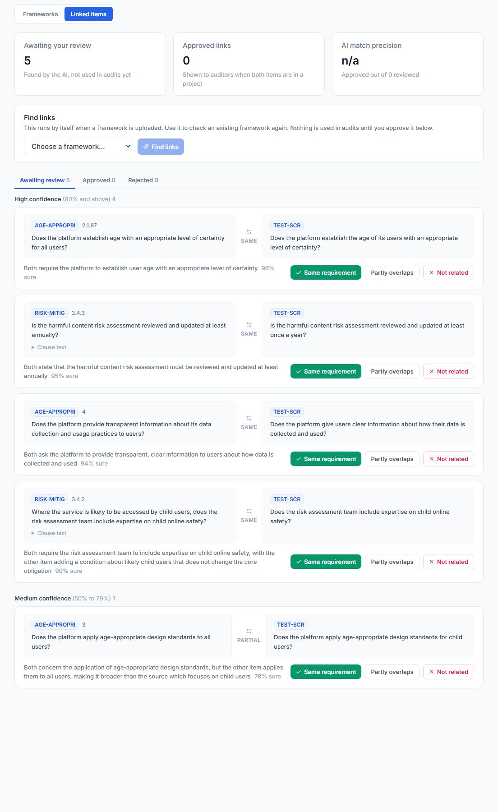
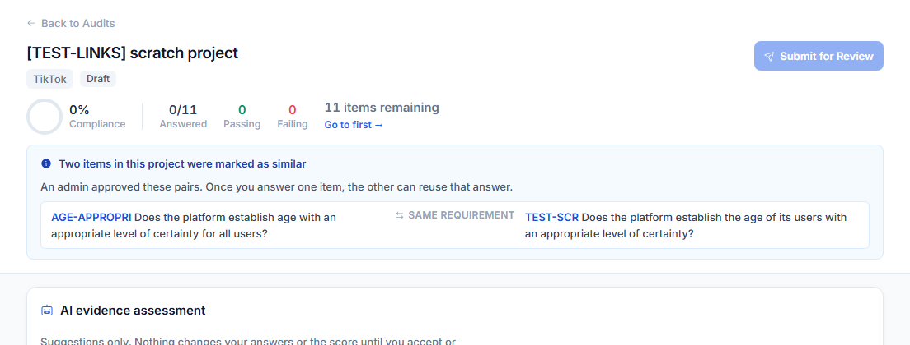
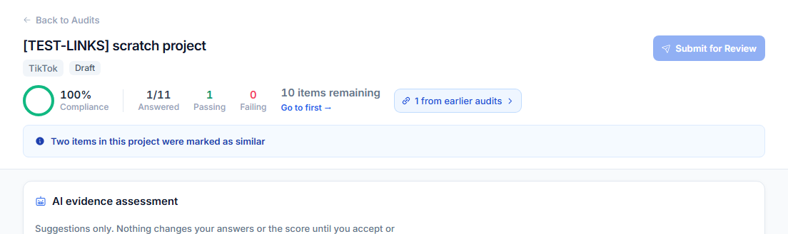
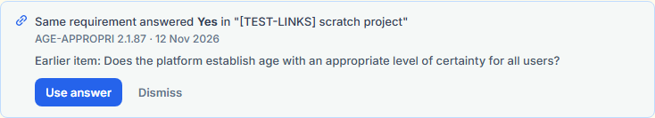

# SafetyAudit: test report for admin-approved similar items and answer reuse

**Date:** 11 November 2026
**Branch:** `feat/ai-evidence-assessment`
**Feature:** when a guideline is uploaded, the AI compares each new checklist item with every item already in the database and saves the similar pairs with a confidence score. An admin approves or rejects each pair, grouped by confidence. Auditors then see a message when two approved-similar items are both in their project, and can reuse an answer.
**Tested by:** Claude Code, at the project owner's request

---

## 1. What changed since the previous version

The feature came in with PR #13 as an admin library of links. It was reworked twice on 11 November. The latest request puts the admin back in charge, with the AI doing the first pass on every upload:

| Previous version (auditor button) | Now |
|---|---|
| An auditor pressed **Find similar items** and the AI compared only that project's items | **No button.** The AI runs by itself when a guideline is uploaded and compares the new items with **all other guidelines' items** |
| Any pair found could be used straight away | Pairs are **awaiting review** until an **admin** approves them. Only approved pairs reach auditors |
| No score shown | Every pair has an **AI confidence score**, and the admin screen groups them: **High 80%+, Medium 50 to 79%, Low under 50%** |
| Roles: auditor or head auditor | Admin decides. Auditors and head auditors see the approved pairs of their project; auditors reuse the answers |

## 2. How it works

1. **Upload.** The admin uploads a guideline. The upload answers at once; in the background the AI shortlists look-alike items by shared words and asks Groq (`openai/gpt-oss-120b`) whether each pair is *same requirement* or *partly overlaps*, with a confidence from 0 to 1. Pairs are saved in Supabase (`Item_Mapping`) as `suggested`. A pair already saved is not asked again, and a rejected pair stays rejected.
2. **Admin review.** Guidelines page, **Linked items** tab (admin only). Pairs are shown in three sections by confidence, most confident first. The admin chooses *Same requirement*, *Partly overlaps* or *Not related*. **Find links** re-checks one existing guideline (for guidelines uploaded before this feature).
3. **Auditors.** When two approved-similar items are both chosen for a project, the audit page shows a message listing them. After one is answered, the other shows **from earlier audits** with the earlier item's text; *Use answer* copies the status, findings and photos. Pairs that are not approved, or were rejected, show nothing.

## 3. Summary

| Area | Result |
|---|---|
| Backend tests | **2 862 / 2 862 pass** (80 of them for this feature), type check clean. An earlier run made while the browser tests were also running showed 26 time-outs in the evidence browser-capture code; they passed when the suite ran alone. |
| Frontend tests | **365 / 365 pass**, type check clean |
| Browser end-to-end tests (Playwright) | **7 / 7 pass** (their stub needed an entry for the new message request) |
| Live test: real database, real Groq, real pages | **Passes** (35 checks), with an intermittent network problem described in section 6 |

## 4. Automated tests for this feature

| Part | What is checked |
|---|---|
| Matching (service) | The AI is offered items from **all** other guidelines; every new pair is saved as `suggested` with its confidence; the prompt asks the model to spread its scores; a rejected pair is not suggested again; unreadable or invented replies are ignored; explanations are in plain words |
| Admin list and decision | Pairs come most confident first, pairs without a score last; can be limited to one guideline; a pair whose item is gone is left out; a decision stores status, reviewer and time; an unknown pair gives 404 |
| What auditors get | Only **approved** pairs appear in a project's message and in answer suggestions; `suggested` and `rejected` pairs do not; same-project and earlier-approved-project answers still work; accept never overwrites and never accepts a *partly overlaps* pair in bulk |
| Routes (over HTTP) | Admin only for list, decide and **Find links** (403 for auditor and head auditor, 401 signed out); bad ids, statuses and relations give 400; AI failure gives a readable 502; a second check on the same guideline gives 409; the old project button route is gone; the message route allows only people on the project |
| Admin screen | Loading and error states; High, Medium and Low sections with sort order; empty sections hidden; tabs by status with counts; approve, reject and save-failure; **Find links** |
| Confidence groups | Limits at exactly 80% and 50%; a missing score counts as low; the original list is not changed |
| Audit page message | Hidden when there is nothing to show or loading fails; one pair and several pairs worded correctly |

## 5. Live test: real database, real AI, real pages

**Setup:** demo accounts, the real Supabase database, real Groq. The admin uploads a small scratch guideline `[TEST-LINKS] Scratch Code` (6 items worded like items in two existing guidelines, plus one unrelated item). A scratch project `[TEST-LINKS] scratch project` uses it. Everything created was removed afterwards and all 8 tables matched a snapshot taken before.

| Step | Result |
|---|---|
| Admin uploads the guideline | Answers in about 1 second; **matching starts by itself** |
| After about 30 seconds | **5 pairs saved**, all `awaiting review`, every pair with a confidence between 0 and 1 (here 0.78 to 0.96) |
| Auditor and head auditor try to list, decide or start a check | **Refused (403)** every time |
| Admin screen | Pairs in **High** (4) and **Medium** (1) sections, most confident first |
| Admin approves one pair and rejects another | Stored with the admin as reviewer and the time |
| Project that uses both guidelines of the approved pair | Auditor and head auditor see **only the approved pair**; the old button route answers 404 |
| Audit page | Message "Two items in this project were marked as similar"; no **Find similar items** button |
| Auditor answers one item | The other is offered that answer **with the earlier item's text** |
| **Use answer** | Saved in the database with a "Reused from ..." note |
| Admin sends the pair back to review | It **disappears** for the auditor |

**Screenshots**

The admin screen, grouped by confidence (High first, Medium below):

The message on the audit page after the admin approved the pair:

The banner once one item was answered:

The card on the linked item, with the earlier item's text so the auditor can check the match:

## 6. Problems found during this round

| Problem | What happened |
|---|---|
| **Groq connection times out now and then on this computer** | In some live runs the automatic check found nothing: the backend log showed `ConnectTimeoutError` to `api.groq.com` after 10 seconds, while the same address answered fine from a separate command. The app handled it correctly (the upload still succeeded, the failure was logged, nothing half-saved) and the same flow found 5 pairs when the connection worked (28 to 33 seconds in three runs). Because it is a network problem outside the app, I did not change the app for it. If it happens in real use, the admin can press **Find links** on that guideline to run the check again. |
| Deleting a guideline leaves its row | `DELETE /api/guidelines/:id` removes the checklist and its items (and so the pairs) but leaves the `Guideline` row. This was already the case before this work; my clean-up removes the row itself. |
| My script waited too briefly | The audit page now loads slowly when a project holds a big guideline. The script now waits for the page. This was a script problem, not an app problem. |

## 7. Limits and risks

| Item | Note |
|---|---|
| Cost and time | Every upload sends the new items to Groq in batches (about 30 seconds for 6 items). A large guideline can take several minutes and many tokens. It runs in the background. |
| No pairs for guidelines uploaded earlier | Existing guidelines have no saved pairs (the old ones were deleted at the owner's request). The admin runs **Find links** once per guideline. |
| Quality | The AI's confidence is its own estimate, not a measured accuracy. In this run it gave 0.9 and above to pairs that really are the same, and 0.78 to a pair that was broader on one side, which suggests it is useful, but one run is a small sample. The admin's decision is the check. |
| **Use all** | Still copies every *same requirement* answer at once for an auditor. Pairs are admin-approved, but it could be removed if that is too trusting. |
| Old table | `Project_Mapping_Decision` is no longer used. It can be dropped: `drop table "Project_Mapping_Decision";` |
| Head auditors | They see the message but cannot accept or dismiss a reused answer (auditor only). |

## 8. How this was run (to repeat it)

1. `cd backend`, then `PORT=3100 ALLOWED_ORIGINS=http://localhost:5174 npx tsx src/server.ts`
2. `cd frontend`, then `VITE_API_URL=http://localhost:3100/api npx vite --port 5174 --strictPort`
3. Sign in with the demo accounts from `backend/scripts/seedDemo.ts`. The login allows 20 attempts per 15 minutes per address; restart the test backend to reset it.
4. Both servers were stopped afterwards. The backend on port 3000 that was already running was not touched.
